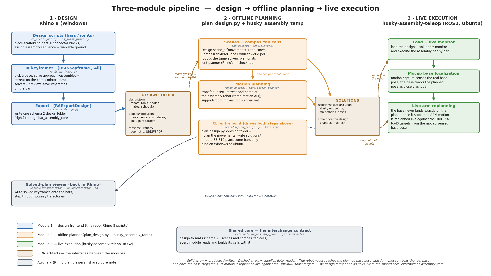

# Bar Joint Rhino Design Workflow

Interactive Rhino 8 scripts for placing scaffolding bars and pluggable
connector blocks ("joint pairs"). The Rhino-facing workflow uses only the
core math stack (`numpy` + `scipy`) and is split into two stages:

- **T1 – Bar axis**: snap a new bar onto an existing bar, or add a brace
  between two bars with interactive solution selection.
- **T2 – Joint placement**: place connector blocks on a bar pair using a
  4-DOF optimizer that aligns the female and male screw holes.

  Each connector family is described by a **joint pair** (a *mate*): a
  receiver + male block definition with the geometry needed to drive the
  optimizer. The receiver is a Female, or the MoCap variant of the same Type
  (a Female with an OptiTrack marker plate). Every joint block is named
  `<Type>_<Subtype>` (`T20_Female`, `T20_Male`, `T20_Ground`, `T20_MoCap`), and
  every other name -- layer, joint id, object name, collision key -- is derived
  from it in `scripts/core/joint_name_conventions.py`. Joint blocks are
  authored interactively in Rhino with `RSDefineJointHalf` /
  `RSDefineJointMate` and
  stored in `scripts/core/joint_pairs.json` along with their `.3dm` block
  assets in `asset/`.

## Three-module pipeline

This repo is the first of three modules that carry a scaffolding design from
Rhino all the way to a real robot:



1. **Design front-end (this repo, Rhino 8 / Windows).** Design the scaffolding
   (bars, joints, assembly sequence, walkable ground), run quick IK keyframe
   checks (`RSIKKeyframe`), then export everything as one **schema 2 design
   folder** (`RSExportDesign`) through the shared core
   [`bar_assembly_core`](https://github.com/jeliag/bar_assembly_core)
   (submodule `external/bar_assembly_core`, format spec in its
   `doc/design_format.md`). The folder carries the complete plan -- robots
   (URDF/SRDF), tools, every bar / joint / ground / obstacle body, the mates,
   every action and movement with its start state and targets -- so the
   downstream modules never read anything from Rhino or from this repo's
   Python config.
2. **Offline planner.** `scripts/plan_design.py <design folder>` plans the
   assembly robot's movements with the motion planner of the
   `external/husky_assembly_tamp` submodule, through the core, and writes
   `solutions/<action>.json` into the design folder.
3. **Live execution ([husky-assembly-teleop], ROS2 / Ubuntu).** Loads the
   design folder and its solutions on the robot. Motion capture localizes the
   mobile base; the base tracks its planned pose as closely as it can, and --
   since it never lands on it exactly -- once the base stops, the **arm**
   motion is replanned live against the **original tool0 targets** using the
   mocap-sensed base pose. Solved plans also flow back into Rhino
   (`RSLoadSolvedBarAction` writes their keyframes onto the bars;
   `RSShowBarActionPlan` right-click scrubs the trajectories).

| Artifact | Produced by | Consumed by |
|---|---|---|
| `<design>/design.json`, `actions/`, `meshes/`, `robots/` | 1 · `RSExportDesign` (also `RSExportAllBarActions`) | 2, 3, 1 (`RSCheckDesign`) |
| `<design>/solutions/<action>.json` (start/end joints, trajectories) | 2 · `scripts/plan_design.py` | 3 (execution), 1 (viewers, `RSLoadSolvedBarAction`) |

Every compas_fab cell -- in Rhino, in the planner and on the robot -- is built
by the core from the design's scenes (`Design.scene_at` ->
`bar_assembly_core.mirrors`): a `CompasFabMirror` (its own PyBullet world) to
plan and check collisions, a `CompasFabCell(visual=True)` to draw. The plugin
never builds a cell from Rhino objects. See
[docs/schema2_integration.md](docs/schema2_integration.md).

After pulling a new version of any submodule, reload Rhino's Python engine
(**ScriptEditor → Tools → Reload Python 3 (CPython) Engine**) so no stale
module copies linger.

[husky-assembly-teleop]: https://github.com/yijiangh/husky-assembly-teleop

## Rhino 8 Workshop Install (Start Here)

### 1. Get the repository onto your machine

Use either option:

- **Clone with Git**

  ```bash
  git clone https://github.com/<org>/bar_joint_rhino_design_workflow.git
  ```

- **Download ZIP** from GitHub, then unzip it to a local folder (for example, inside Documents).

Example install location:

`C:\Users\<your-user>\Documents\bar_joint_rhino_design_workflow`

### 2. Configure Rhino 8

1. Open **Tools -> Options -> Files -> Search Paths**.
2. Add the repository's `scripts` folder.
   Example:
   `C:\Users\<your-user>\Documents\bar_joint_rhino_design_workflow\scripts`
3. Open **Tools -> Toolbars -> File -> Open Toolbar File...**.
4. Select `scaffolding_toolbar.rui` from the repository root.
5. Show and dock the **RSDesign** and **RSSetup** toolbars (plus **RSStability**
   if you exchange layouts with the stability simulation).

### 3. Run any toolbar command once

**No manual pip install is needed for Rhino usage.** The Python packages of
all commands are listed once, in [requirements-rhino.txt](requirements-rhino.txt).
The first command you run installs them, with one pip call, into
`%LOCALAPPDATA%\bar_joint_rhino\python\py39-<hash>` (`scripts/rhino_env.py`);
every command then puts that folder on `sys.path` before it imports anything.

- **First run: several minutes, and Rhino does not respond meanwhile.** pybullet
  has no ready-made build for Python 3.9 on Windows, so pip compiles it. That
  needs **Visual Studio Build Tools** with the workload *Desktop development
  with C++* ([download](https://visualstudio.microsoft.com/visual-cpp-build-tools/)).
  Without it the command stops with a message saying so; install it and run the
  command again. pip caches the build, so later installs take about a minute.
- The install log is `%LOCALAPPDATA%\bar_joint_rhino\python\py39-<hash>.log`.
- Editing `requirements-rhino.txt` makes the next command install a fresh folder
  (the hash changes); the old one can be deleted once Rhino is closed.
- The scripts have **no** `# venv:` or `# r:` lines, on purpose: Rhino installs
  each `# r:` line with its own pip call, so a later package overwrote the pins
  of an earlier one (scipy installed numpy 2.0.2 over 1.24.4, compas_robots
  compas 2.15.1 over 2.13.0), which broke fresh installs. Do not add them back;
  add the package to `requirements-rhino.txt` instead.
- Upgrading from the old setup: nothing to do. The old
  `~\.rhinocode\py39-rh8\site-envs\scaffolding_env-*` folder is no longer used
  and can be deleted. If a command warns that a package is loaded from outside
  the new folder, restart Rhino.

## Setup (Robotic workflows and tests)

### Submodule dependencies for the IK workflow

The planning workflow (RSIKKeyframe, the plan viewers, the Grasshopper
preview) builds its compas_fab cells through the shared core
[`bar_assembly_core`](https://github.com/jeliag/bar_assembly_core), vendored at
`external/bar_assembly_core`, which plans with a specific development branch of
[compas_fab](https://github.com/compas-dev/compas_fab/tree/wip_process),
vendored at `external/compas_fab`, rather than pulled from PyPI --
this keeps iteration on the branch deterministic and avoids the pip-cache SHA
gotcha described in [tasks/yh_lesson.md](tasks/yh_lesson.md).

After cloning this repo (or pulling changes that touch the submodules), run:

```bash
git submodule update --init --recursive
```

`scripts/core/core_lib.py` prepends `external/bar_assembly_core` and
`external/compas_fab/src` onto `sys.path` before any import of them, so Rhino
scripts see the submodule versions automatically. To switch to a different
upstream commit, `cd external/<submodule> && git fetch && git checkout <sha>`,
then reload Rhino's Python engine.

The remaining dependencies (`compas`, `compas_robots`, `pybullet`,
`pybullet_planning`, `roslibpy`, `trimesh`, plus `numpy` / `scipy`) come from
[requirements-rhino.txt](requirements-rhino.txt) (see step 3 above). Do **not**
add `compas_fab` or `bar_assembly_core` to it -- that would bypass the
submodules and silently shadow them.

`external/rs_data_structure` (the old `BarAssemblyAction` schema) is no longer
imported by this plugin; only the core's optional `legacy/` converter (old
exports -> schema 2) still needs it.

A third submodule, [husky_assembly_tamp](https://github.com/yijiangh/husky_assembly_tamp) at `external/husky_assembly_tamp`, is the **offline planner** (module 2 of the pipeline above). It also hosts the code shared between Rhino and offline planning: the dual-arm IK solvers, the keyframe chain solve, the walkable-ground base search, and their tuning constants (`husky_assembly_tamp.keyframe`). `scripts/core/config.py` puts it on `sys.path`, so Rhino commands import the solvers from there — one implementation for both the quick in-Rhino IK check and the headless planner.

### Analytical IK solver (ssik) — one-time venv

[ssik](https://github.com/personalrobotics/ssik) is the analytical IK solver behind `RSIKKeyframe` (and the headless planner) — closed-form inverse kinematics generated straight from our calibrated URDF (no tuning constants). It requires **Python 3.11** and ships compiled extensions, so it can't load inside Rhino's CPython 3.9; instead it runs in a small Python 3.11 "sidecar" venv at `external/ssik_env`. The sidecar code and its path resolution live in the tamp submodule (`husky_assembly_tamp.keyframe.config`): the default is `<this repo>/external/ssik_env` + the per-arm solver modules at `<this repo>/asset/ssik`, overridable per machine with the `HUSKY_SSIK_VENV_DIR` / `HUSKY_SSIK_ARTIFACT_DIR` environment variables. The scripts start and talk to the sidecar automatically. (Offline planning in a Python 3.11 venv imports ssik **in-process** instead — no sidecar; the sidecar is a Rhino-only workaround.)

**Until both exist, the Rhino commands use the `gradient` backend automatically** (`scripts/rhino_env.py` says so once per session). The built solver modules (`left_ur_arm_ik.py`, `right_ur_arm_ik.py`) are not in the tamp commit this repo pins: they are committed on tamp branches such as `yh/ssik-speedup`, at the tamp repo's own `asset/ssik`. Copy them to `<this repo>/asset/ssik`, or point `HUSKY_SSIK_ARTIFACT_DIR` at them.

You do **not** need Python 3.11 to be your system/default interpreter — your everyday `python` can stay 3.8–3.10. The easiest way is [uv](https://docs.astral.sh/uv/), a standalone tool (not run "through" your Python). Install it once (needs no Python):

- **Windows** (PowerShell): `powershell -ExecutionPolicy ByPass -c "irm https://astral.sh/uv/install.ps1 | iex"`
- **macOS / Linux**: `curl -LsSf https://astral.sh/uv/install.sh | sh`

(Or `pip install uv` to use your existing Python instead.) Then create the venv and install ssik:

```bash
uv venv --python 3.11 external/ssik_env
uv pip install --python external/ssik_env ssik
```

That's the whole setup. Run `RSIKKeyframe` -- the sidecar spawns on the first solve and is shut down by `RSPBStop`.

There is also a pure-PyBullet `gradient` backend that runs inside Rhino's own Python with no venv — slower, kept as a fallback for environments that can't host the 3.11 sidecar and for benchmarking against ssik. Select it with the `HUSKY_IK_BACKEND=gradient` environment variable (default is `ssik` when it is set up, else `gradient`; see `husky_assembly_tamp.keyframe.config` and `scripts/rhino_env.py`). To regenerate the solver modules after a URDF change, see [external/husky_assembly_tamp/husky_assembly_tamp/keyframe/ssik_sidecar/README.md](external/husky_assembly_tamp/husky_assembly_tamp/keyframe/ssik_sidecar/README.md).

### Optional developer install

Use `requirements-dev.txt` when you want the optional tooling:

- PyBullet viewers
- pytest
- matplotlib-backed test visualization
- URDF/PyBullet validation work

Recommended from a normal local Python environment or virtualenv:

```bash
python -m pip install -r requirements-dev.txt
python -m pytest -q
```

> **Tip for developers:** The design folder's `design.json`, `actions/*.json` and `solutions/*.json` can be large and deeply nested. [Janice](https://github.com/ErikKalkoken/janice) is a handy desktop viewer for browsing and searching big JSON files without loading everything into a text editor.

## Rhino 8 Workflow

See [docs/coordinate_conventions.md](docs/coordinate_conventions.md) for
the bar/block frame conventions and
[docs/rhino_toolbar_entrypoints.md](docs/rhino_toolbar_entrypoints.md)
for the canonical Rhino entrypoint reference:

- one complete toolbar button table (toolbar/button/script/primary use)
- detailed per-entrypoint behavior and prerequisites
- manual ScriptEditor macro pattern (`! _-ScriptEditor _R "rs_<name>.py"`)

### Typical design loop

1. Create or import bars.
2. Snap/brace bars and assign sequence.
3. Place and edit joints.
4. Run IK keyframe tools when needed.
5. Export debug or prefab artifacts as needed.

### Blank-canvas quick start

- Start from a new empty Rhino file.
- Draw one simple line (for example with the `Line` command).
- Run **RSCreateBar** to register that line as your first bar and generate its preview.
- Draw a second line and repeat **RSCreateBar** if you want to test **RSBarSnap** and **RSBarBrace** next.
- Use joint-definition tools only after you author or import matching block definitions for your chosen joint family.

### Stability-simulation exchange (RSStability toolbar)

The stability simulation exchanges whole layouts as a `node_list` /
`rod_list` / `coupler_list` JSON (see `large_scaffold.json`), where each rod
is one bar (`rod_id` = the Rhino `bar_id`) and `coupler_list` holds the
rod-to-rod connectivity:

1. **RSImportScaffoldJSON** — pick the JSON; it bakes one registered bar per
   rod, named `B<rod_id>`, sequenced bottom-up by `layer_id` then `rod_id`.
   Every field of the source file is stored (per-rod fields on the bar
   curve, `coupler_list` and anything else in document user text) so nothing
   is lost by the trip through Rhino.
2. Design as usual — **RSBarSnap** to push each coupled bar out to its joint
   contact distance, then joint placement.
3. **RSExportScaffoldJSON** — writes the same schema back out with the
   node positions taken from the snapped geometry. A node whose bars have
   been pulled apart is split into one node per position (the original id
   stays with the lowest-numbered rod); connectivity is unaffected because
   it lives in `coupler_list`. Before saving it prints a sanity report:
   the actual gap for every coupled pair, plus any uncoupled bars whose
   tubes overlap.

With nothing moved between import and export, the exported file is
identical to the imported one (covered by `tests/test_scaffold_json.py`).

## Standalone Developer Tools

Most of these run from a terminal, not from Rhino buttons. The `T1-S2` case exporter below is the one Rhino-side debugging exception because it captures live Rhino picks and the current solver output.

### Export T1-S2 debug case

Rhino command:

```text
! _-ScriptEditor _R "rs_export_case.py"
```

What it does:

- Exports the current `T1-S2` selection as a JSON debug case so the exact Rhino input can be replayed outside Rhino.
- Captures:
  - `Le1` and `Le2` line endpoints
  - picked contact points `Ce1` and `Ce2`
  - current `BAR_CONTACT_DISTANCE` and `BAR_RADIUS`
  - Rhino document path and model units
  - the live `solve_s2_t1_all(...)` result count and solution data, or the solver error if one is raised

  Typical workflow:

1. Run `RSBarBrace` until you hit an `S2` case you want to inspect more closely, such as fewer preview candidates than expected or a suspicious candidate layout.
2. Run `rs_export_case.py` from Rhino (or click the `RSExportCase` toolbar button in `scaffolding_toolbar.rui`).
3. If the last `T1 Bar` run was already an `S2` selection, choose `Yes` to reuse the cached `Le1`, `Le2`, `Ce1`, and `Ce2`.
4. Pick a save path. The default location is `tests/debug_cases/`.
5. Commit or share the exported JSON file as a reproducible failing case.

Replay it outside Rhino:

```bash
python - <<'PY'
import json
import numpy as np
import sys

sys.path.insert(0, "scripts")
from core.geometry import solve_s2_t1_all

with open("tests/debug_cases/your_case.json", "r", encoding="utf-8") as stream:
    case = json.load(stream)

solver_input = case["solver_input"]
nn_init_hint = solver_input["nn_init_hint"]
solutions = solve_s2_t1_all(
    np.array(solver_input["n1"], dtype=float),
    np.array(solver_input["ce1"], dtype=float),
    np.array(solver_input["n2"], dtype=float),
    np.array(solver_input["ce2"], dtype=float),
    float(solver_input["distance"]),
    nn_init_hint=None if nn_init_hint is None else np.array(nn_init_hint, dtype=float),
)

print(f"{len(solutions)} solution(s)")
for index, solution in enumerate(solutions, start=1):
    print(index, solution["angles"], solution["residual"])
PY
```

### Generate URDF

```bash
python scripts/generate_urdf.py
```

What it does:

- Converts the current CAD-backed connector definition in `scripts/core/config_generated.py` into `scripts/T20_5_chain.urdf`.
- Encodes the chain:
  - `Le bar -> FJP -> FJR -> female link -> female screw hole -> JJR -> male screw hole -> male link -> MJR -> MJP -> Ln bar`

  When to use it:

- Run it after `Export CAD Config` whenever the Rhino-authored reference frames change.
- Use it when you want the URDF file on disk for inspection, testing, or other downstream tooling.

Requirements:

- Core runtime only (`requirements.txt`)

### Static PyBullet URDF viewer

```bash
python scripts/pb_viz_urdf_static.py
```

What it does:

- Regenerates the URDF automatically.
- Loads the connector chain in a fixed PyBullet scene.
- Applies transparent colors and draws frame annotations so you can inspect link names, frame locations, and mesh placement.

When to use it:

- Use this right after a CAD export when you want a quick visual sanity check of the generated URDF structure before touching interactive debugging.
- It is good for checking whether the fixed transforms and mesh orientation look plausible.

Requirements:

- Developer runtime (`requirements-dev.txt`)

### Interactive PyBullet viewer

```bash
python scripts/pybullet_viewer.py
```

What it does:

- Regenerates the URDF automatically.
- Opens a PyBullet GUI with sliders for `FJP`, `FJR`, `JJR`, `MJR`, and `MJP`.
- Runs live FK sanity checks against the URDF link states.
- Runs the optimizer in the background and overlays ghost meshes for the solved female and male placements.

Typical workflow:

1. Move the sliders to create a test joint state.
2. Watch the live FK and optimization status line in the terminal.
3. Press `1` to print a detailed FK report.
4. Press `2` to print a detailed optimizer report.
5. Press `h` to print the help text again.

When to use it:

- Use this for debugging the relationship between the CAD-backed FK, the URDF, and the optimizer behavior.
- This is a developer tool, not part of the Rhino button workflow.

Requirements:

- Developer runtime (`requirements-dev.txt`)

## Tests

```bash
python -m pytest -q              # all tests
python -m pytest -q --viz        # with matplotlib visualisations
```

| Test file | What it covers |
|-----------|----------------|
| `test_geometry.py` | Line-line distance, closest points, finite segments |
| `test_s2_t1.py` | S2-T1 bar-axis solver (single + all solutions) |
| `test_joint_pair_roundtrip.py` | Joint-pair registry + canonical bar frame round-trip |
| `test_three_bar_scene.py` | End-to-end pair-placement optimizer on a 3-bar scene |
| `test_design_source.py`, `test_design_builder.py` | Rhino document (fake API, rhino3dm) -> schema 2 design |
| `test_design_planning.py` | Planning on the core's mirrors: keyframe chain, support IK, contacts, `plan_design.py` |
| `test_design_display.py`, `test_plan_steps.py` | Drawing cells, the viewers' steps, solutions read back |

## Project Structure

This is a curated map of the files that matter most when learning or extending the project.

```text
scaffolding_toolbar.rui                 # Rhino toolbar buttons/macros
docs/rhino_toolbar_entrypoints.md       # Canonical table of toolbar -> script mapping + detailed command behavior

scripts/
  core/
    config.py                           # Runtime config + sanitized access to generated values
    joint_pair.py                       # Core data model: JointHalfDef, GroundJointDef, JointPairDef, JointRegistry
    joint_pairs.json                    # Joint registry data authored from Rhino
    rhino_bar_registry.py               # Bar registry CRUD + bar metadata in Rhino user text
    geometry.py                         # Core geometry and S2-T1 solver utilities
    joint_pair_solver.py                # Pair-specific joint solving utilities
    joint_name_conventions.py            # Every joint/bar/tool/collision NAME, from <Type>_<Subtype>
    joint_name_migration.py             # One-off rename of legacy names in old .3dm files
    joint_placement.py                  # Joint pair placement computation and bake helpers
    single_sided_placement.py           # Ground / standalone MoCap placement on one bar
    marker_points.py                    # MoCap marker spheres between block / world / bar frames
    design_source.py                    # Rhino document -> schema 2 design (bar_assembly_core)
    design_builder.py                   # Keyframe records -> the design's actions (Rhino-free)
    design_planning.py                  # Design scenes -> the core's CompasFabMirror -> tamp / compas_fab solvers
    design_display.py                   # Design scenes -> the parts ik_viz draws (no compas, no PyBullet)
    plan_steps.py                       # The viewers' poses, timeline and solutions as moments of the design
    keyframe_store.py                   # Solved keyframes in bar user text (the persistent store)
    support_ik.py                       # Support-arm IK on a lent planner
    core_lib.py                         # Puts bar_assembly_core + compas_fab (submodules) on sys.path
    ik_viz.py                           # Rhino preview cache: a core Scene baked part by part
    scaffold_json.py                    # node/rod/coupler layout-JSON round trip, for the
                                        #   stability-simulation exchange (see RSStability below)
    robotic_tool.py                     # Robotic tool registry helpers

  # Main Rhino entry points used most often in workshops
  rs_create_bar.py
  rs_bar_snap.py
  rs_bar_brace.py
  rs_sequence_edit.py
  rs_joint_place.py
  rs_joint_edit.py
  rs_bar_edit.py
  rs_define_joint_half.py
  rs_define_joint_mate.py
  rs_update_preview.py
  rs_reorder_bar_id.py
  rs_export_prefab.py
  rs_measure_gap.py
  rs_ik_keyframe.py                     # IK keyframes (assembly + support flows), on the core
  rs_show_bar_action_plan.py            # Plan viewer (keyframes; right-click: planned motion)
  rs_show_assembly_plan.py              # Whole-assembly stepper
  rs_load_solved_bar_action.py          # Solutions -> bar keyframes

  # Planning/export and mocap entry points
  rs_export_design.py                   # Document -> schema 2 design folder (+ file and plan checks)
  rs_check_design.py                    # File and plan checks of a design folder
  plan_design.py                        # Headless: plan a design folder's movements, write solutions/
  rs_rebuild_robot_cell.py              # Walkable-ground passes + rebuild the core's cells (RSPBStart too)
  rs_read_mocap_bar.py
  rs_align_model_three_bars.py

  # RSStability toolbar: exchange with the stability simulation / layout generator
  rs_import_scaffold_json.py            # layout JSON -> registered bars (bar_id = B<rod_id>)
  rs_export_scaffold_json.py            # registered bars -> the same JSON schema

tests/
  test_geometry.py
  test_s2_t1.py
  test_joint_pair_roundtrip.py
  test_three_bar_scene.py
  test_design_*.py, test_plan_steps.py  # Design export, planning and drawing through the core

external/
  bar_assembly_core/                    # Shared core: design format, scenes, compas_fab cells (git submodule)
  compas_fab/                           # IK/planning dependency of the core (git submodule)
  rs_data_structure/                    # Old BarAssemblyAction schema (only the core's legacy/ converter)
  husky_assembly_tamp/                  # Planner (git submodule): keyframe + motion solvers

asset/
  *.3dm                                 # Joint/block assets used by placement workflows
  husky_urdf/                           # Robot description assets used by IK workflows
```

For the full list of Rhino commands and what each one does, see
[docs/rhino_toolbar_entrypoints.md](docs/rhino_toolbar_entrypoints.md).
